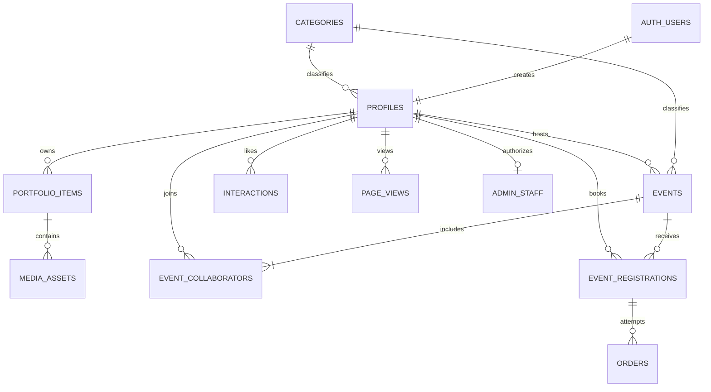

# Happenfolk architecture

The team application uses Next.js App Router, React, TypeScript and Tailwind with the Happenfolk shared design system. Supabase supplies Auth, Postgres, PostgREST, Storage and scheduled retention. Vercel hosts the web application. Public browser configuration is validated in `src/lib/env.ts`; privileged credentials remain in server media operations and operator/test scripts.

`profiles.id` references Auth users with cascading deletion. Categories are the seven fixed Music, Photography, Visual Arts, Performance, Design, Film and Food rows. Profiles use `headline`, `location`, `website`, `contact_email` and `open_to_collaborate`. `events.open_to_collaborate` is a separate event-level availability flag. Works have ordered positions, year/tags and media metadata. Media originals reside in private `drafts`; public derivatives reside in `media`, with avatars/covers in their own public buckets. Storage bytes require API cleanup separately from database row deletion.

`interactions`, `page_views` and `page_views_monthly` use polymorphic `(subject_type, subject_id)` for event/profile/work subjects rather than three foreign keys. Raw page views optionally reference a viewer; monthly aggregates hold only month, subject and count. Subject analytics must be explicitly removed by cleanup tools when deleting whole sample datasets.

## Access model

All public tables have RLS enabled. Browser and request-scoped server clients carry anonymous/member credentials, so application validation is backed by database policies, column grants, constraints and RPC authorization. Public discovery and detail pages expose published, non-hidden content; work visibility also requires a public owner. Owners can preview their own private profiles; work-detail previews remain in the dashboard. Streamed Next not-found pages can send 200 headers before the not-found marker and `noindex` arrive.

A host is automatically added to `event_collaborators`. Every listed collaborator may make ordinary event edits; host-only operations manage rosters and deletion. Host identity is immutable. Event edits validate field allowlists and stale timestamps, and client routes do not accept price/capacity edits. Registrations and orders are private to their member. Registration serializes seat allocation with an event lock; pending, confirmed and payment-failed registrations occupy seats until cancellation. Free registrations confirm immediately. Paid registrations create pending orders, and per-order simulation settles success/failure without real money. Terminal order outcomes are immutable; cancelled registrations cannot be charged.

Staff status comes from the inaccessible `admin_staff` register, not editable profiles. Admin RPCs recheck staff status. Hidden profiles, events and works are removed from public RLS, discovery/search and public detail responses. Hiding does not revoke previously shared public image URLs. There is no implemented admin audit ledger.

Mutation routes check origins and identity; profile editing uses a server action and owner-RLS writes. Media upload validates signatures, strips identifying metadata from public derivatives, and coordinates concurrent publish/unpublish/avatar operations with database leases. Publishing requires media and accessible alt text; a published work cannot lose its last media row through a direct media mutation.

## Discovery and telemetry

Trending events/artists use recent time-decayed views. Recommended views rerank using the member's category affinity from likes and views. Search RPCs combine bounded text/trigram matching and category filters. The homepage can fall back to latest public data before telemetry exists.

`/api/views` verifies subject visibility, strict body shape and request identity. Signed-in views pin `auth.uid()`. Anonymous views require a trusted proxy IP and original user agent; local requests without trusted identity are skipped. Raw IP/user-agent values are used for identity derivation and never returned or logged. The daily 03:17 UTC retention job serializes aggregation and purges views older than 90 days; monthly counts contain no viewer identifier. `/api/likes` delegates authenticated toggles to the database and returns aggregate counts.

## Test architecture and CI

Vitest unit suites run without a database under `npm test`. Stack-dependent directories are excluded explicitly. `tests/access` creates distinct real users for policy assertions; privileged SQL is fixture/cleanup/red-guard infrastructure. Auth tests start an actual Next production server, rebuild stale inputs and capture real Supabase SSR cookies. Media/events/portfolio/discovery/payments suites exercise their respective database, Storage and HTTP contracts.

`tests/integration/01-seed-integrity.spec.ts` checks sample volume, category coverage, event mixes, collaborators and public filtering. `02-live-journey.spec.ts` reuses the auth server lifecycle, tests populated HTML and hidden/draft boundaries, and executes the same smoke/e2e scripts operators run. The e2e covers public signup, owner-RLS onboarding, real image upload/publish/download, free RSVP/cancel, view/like, paid failure/retry/success and cleanup. It does not drive the profile server-action UI. `tests/compliance` covers legal disclosures, staff authorization, moderation/search visibility, identity-free retention, cron, keyboard focus source guards and sample disclosures.

CI retains the `web`, `invariants` and `database` jobs. The web job runs pure checks/build. The invariants job resets and seeds a local stack, exports masked credentials, uploads generated media, runs existing access/auth/media/events/portfolio/discovery suites, then integration and compliance serially, and stops its stack even on failure. The database job retains migration lint/payment tests. No hosted secrets are needed. Browser smoke is a separate optional Chrome/Chromium probe rather than an assumed CI browser dependency.

## Seed boundaries

`scripts/fixtures/sample-data.mjs` is the shared manifest for checked-in SQL and optional remote API seeding. Local SQL uses deterministic IDs and explicitly marked fictional accounts. `seed:media` selects only exact manifest emails with the sample app-metadata marker and refuses a nonlocal target. Remote seed/unseed require explicit target-specific env and `--yes`; they do not discover linked projects. Unseed removes marked accounts, their owned data and Storage prefixes. Neither sample path grants staff privileges. See the runbook for operation and recovery commands.
